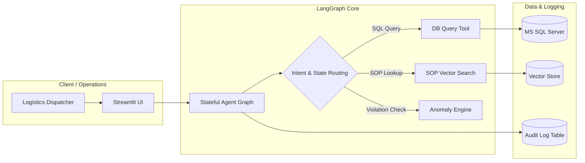

# About the Project: AI Forward Deployed Engineer (FDE)

## 1. What is an AI Forward Deployed Engineer (FDE)?

The **Forward Deployed Engineer (FDE)** role—popularized by companies like Palantir and now foundational across top AI enterprises—operates at the intersection of:
1. **Client Problem Discovery & Enterprise Domain Knowledge**: Understanding unstructured business problems directly from stakeholders.
2. **Legacy Infrastructure Integration**: Connecting cutting-edge AI directly into existing enterprise databases, messy legacy schemas, ERPs, and internal tools.
3. **Applied AI & Agentic Orchestration**: Designing resilient LLM agent architectures (rather than simple chat wrappers) that take deterministic, safe actions.
4. **Production Engineering & DevOps**: Delivering containerized, monitored, compliant, and deployed solutions into client clouds (AWS/GCP/Azure).

This project is tailored precisely around these FDE competencies.

---

## 2. Business Problem & Domain: Cold-Chain Logistics

### The Scenario
In cold-chain logistics (pharmaceuticals, vaccines, fresh produce, frozen meat), maintaining temperature fidelity across transport routes is legally mandated and safety-critical. A single 2°C temperature spike for over 30 minutes can ruin an entire million-dollar shipment.

### The Pain Points
- **Fragmented Data**: Sensor IoT logs (temperature, humidity, vibration) and GPS tracks sit across disparate relational databases (like MS SQL Server).
- **Static Regulatory Docs**: Standard Operating Procedures (SOPs) exist as static PDF/Word documents that human dispatchers rarely cross-reference in real time.
- **Reactive Alerting**: Dispatchers only notice spoilage hours after a route deviation or cooling unit failure occurred.
- **Audit & Compliance Friction**: When a breach occurs, reconstructing who made what decision requires weeks of manual log scraping.

### The AI Solution
An autonomous AI assistant that:
1. Translates human operator natural-language queries into safe, read-only SQL queries against live logistics tables.
2. Cross-references real-time anomalies with ingested SOP documents using Retrieval-Augmented Generation (RAG).
3. Evaluates violation severity and proposes immediate corrective dispatch actions.
4. Persists a cryptographically auditable log of every query, reasoning step, and tool execution.

---

## 3. System Architecture & Components

### Component Breakdown

#### A. Enterprise Relational Database (MS SQL Server in Docker)
* Containerized instance running Microsoft SQL Server for Linux.
* Normalized tables representing trucks, active shipments, telemetry streams, and route checkpoints.
* Principle of least privilege: dedicated read-only roles for agent SQL execution to prevent destructive SQL injection.

#### B. SOP Document Ingestion Pipeline (RAG)
* Ingestion of logistics operating manuals, FDA/HACCP temperature thresholds, and incident protocols.
* Chunking, embedding generation, and vector indexing.
* Enables semantic search when the agent needs context like *"What is the maximum allowed excursion time for vaccine lot B?"*.

#### C. LangGraph Multi-Tool Agent
* Implemented as a cyclic state graph rather than a brittle sequential chain.
* Dynamic decision loop:
  1. Inspect user prompt.
  2. Query database for shipment telemetry.
  3. Detect threshold breaches against SOP guidelines.
  4. Formulate operational recommendations.
  5. Commit audit trail entry.

#### D. Enterprise Audit Trail
* Logs session IDs, raw queries, generated SQL statements, agent thoughts/reasoning, and timestamped actions.
* Essential for enterprise compliance and compliance sign-offs.

#### E. Presentation & Cloud Delivery
* **Frontend**: Interactive Streamlit dashboard with shipment filters, map tracks, and real-time agent dialogue.
* **CI/CD**: GitHub Actions pipeline triggering automated builds and remote deploy scripts.
* **Cloud**: Automated host provisioning on AWS EC2.

---

## 4. Key Learning Goals & Interview Takeaways

By building this project through the tutorial, you will master:
- [x] **Agentic State Management**: Moving beyond standard LangChain chains to LangGraph stateful workflows.
- [x] **Enterprise Text-to-SQL Guardrails**: Secure database querying without allowing arbitrary `DROP`/`UPDATE` operations.
- [x] **Hybrid AI Systems**: Blending structured relational data (SQL) with unstructured knowledge (Vector DB / SOPs).
- [x] **Production Deployment**: Real-world deployment to AWS EC2 using Docker and GitHub Actions CI/CD.
- [x] **FDE Mindset**: Framing technical engineering around enterprise ROI, compliance, and reliability.

---

## 5. Notes & Preparation

When you are ready to begin coding alongside the video:
1. Make sure your local Docker daemon is running (`docker info`).
2. Verify Python environment activation (`.venv`).
3. Have your LLM API keys ready in a `.env` file (never commit secrets to Git).

> **Video Link:** [Complete End To End AI Forward Deployed Engineer(FDE) Project Implementation](https://www.youtube.com/watch?v=FSZhPDzESPU)

