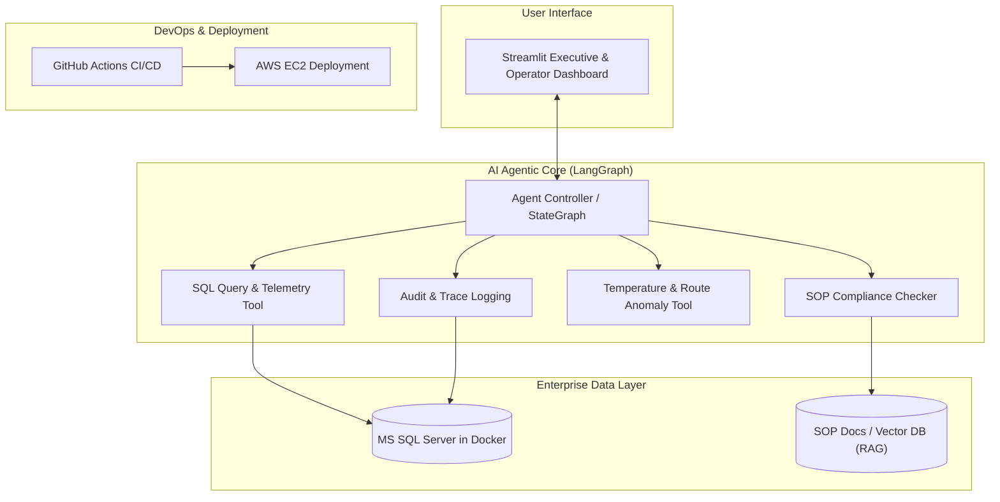

# AI Forward Deployed Engineer (FDE) - Enterprise Cold-Chain Logistics Agent

> **Reference Tutorial:** [Complete End To End AI Forward Deployed Engineer(FDE) Project Implementation](https://www.youtube.com/watch?v=FSZhPDzESPU)

---

## 📌 Project Overview

This project simulates the real-world role of an **AI Forward Deployed Engineer (FDE)**—transforming an enterprise legacy system into an autonomous, production-ready AI agentic solution.

Using a real-world **Cold-Chain Logistics** use case (monitoring perishable cargo, truck GPS, refrigeration telemetry, and route compliance), this project builds an intelligent agent that can query enterprise SQL databases, verify regulatory Standard Operating Procedures (SOPs), detect anomalies, trigger actionable recommendations, and log all agent actions for enterprise audit compliance.

---

## 🏗️ High-Level Architecture

---

## 🧰 Tech Stack

| Domain | Technology / Tool |
| :--- | :--- |
| **Agentic Framework** | [LangGraph](https://github.com/langchain-ai/langgraph), [LangChain](https://github.com/langchain-ai/langchain) |
| **LLMs & Embeddings** | OpenAI (GPT-4o / GPT-4o-mini) or Groq / Open Source LLMs |
| **Database** | Microsoft SQL Server (Containerized via Docker) |
| **Knowledge Retrieval (RAG)**| ChromaDB / FAISS for SOP ingestion |
| **Frontend UI** | Streamlit |
| **Containerization** | Docker & Docker Compose |
| **CI/CD Pipeline** | GitHub Actions |
| **Cloud Hosting** | AWS EC2 (Ubuntu Linux instance) |

---

## 🗺️ Step-by-Step Implementation Roadmap

- [ ] **Milestone 1: Environment & Enterprise Database Setup**
  - Spin up MS SQL Server instance inside Docker.
  - Create cold-chain schema: `Trucks`, `Shipments`, `TelemetryLogs`, `Routes`, and `AuditLogs`.
  - Populate realistic mock telemetry (GPS coordinates, timestamped temperatures).

- [ ] **Milestone 2: SOP Knowledge Ingestion (RAG)**
  - Collect & chunk cold-chain regulatory guidelines and standard operating procedures.
  - Embed and store in vector database for agent reference during temperature breach events.

- [ ] **Milestone 3: Agentic Tools & LangGraph State Machine**
  - Construct specialized tools: SQL execution tool (with schema guardrails), SOP lookup tool, and anomaly calculator.
  - Define state graph, transitions, and conditional routing using LangGraph.

- [ ] **Milestone 4: Audit Logging & Guardrails**
  - Implement full traceability: record prompt, agent rationale, executed queries, and outputs into the enterprise audit table.

- [ ] **Milestone 5: Streamlit Interface Development**
  - Interactive operator chat interface.
  - Telemetry visualization & shipment risk status cards.

- [ ] **Milestone 6: Cloud Deployment & CI/CD**
  - Containerize the complete application stack using `docker-compose`.
  - Configure GitHub Actions workflow for automated testing and deployment to AWS EC2.

---

## 📋 Prerequisites Checklist

Before beginning the implementation steps from the video:
1. **Docker Desktop** installed and running on your machine.
2. **Python 3.10+** virtual environment active.
3. **API Keys**: OpenAI API Key (or Groq / alternative LLM provider).
4. **AWS Account**: Free-tier eligible EC2 instance access for deployment.
5. **Git & GitHub Repository**: Set up for CI/CD workflow triggers.

---

*Note: For detailed domain background, architectural deep-dive, and FDE role breakdown, see [ABOUT_PROJECT.md](file:///c:/Users/suraj/OneDrive/Desktop/My_Work/Interview_Learnings/Projects/ABOUT_PROJECT.md).*

